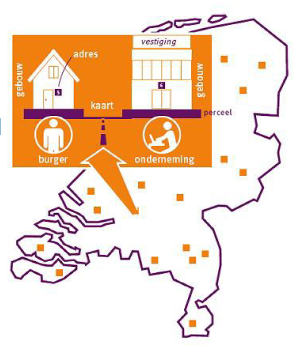
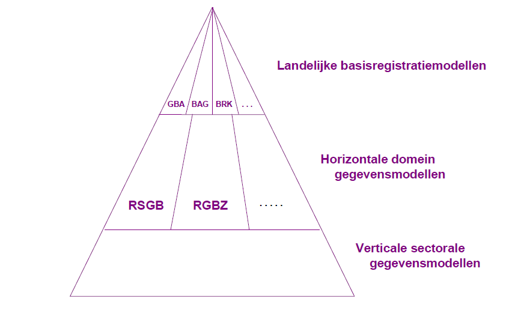
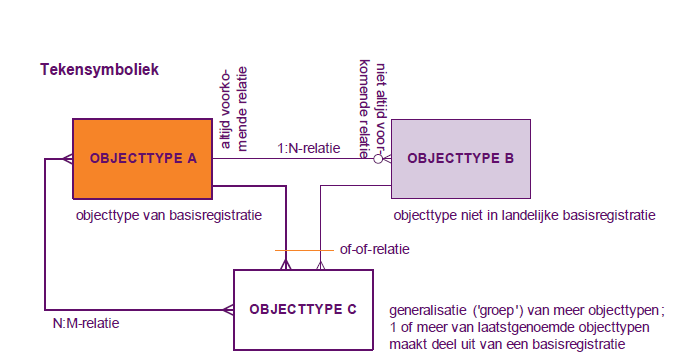
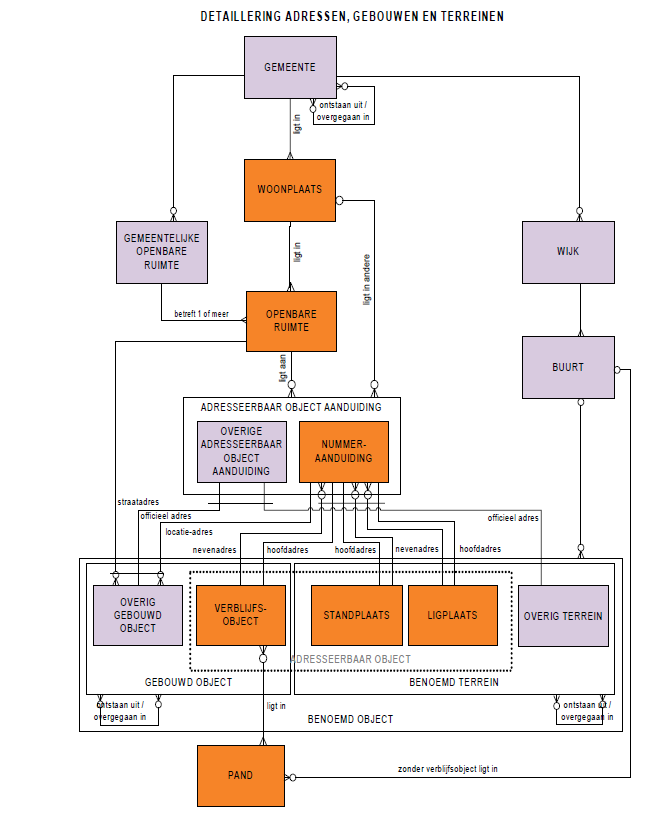
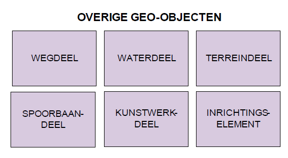
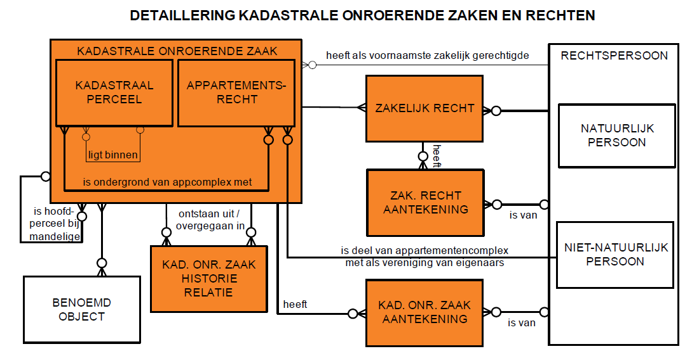
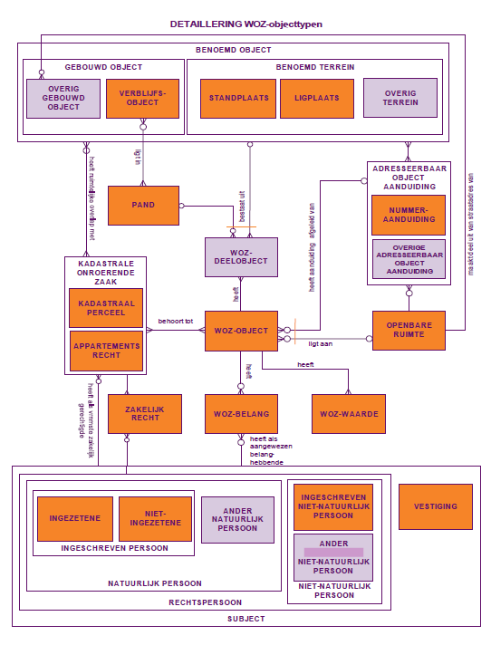
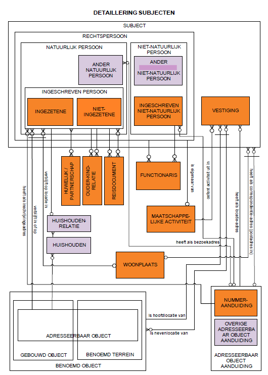

# Objectenmodel (oud)

In dit hoofdstuk bakenen we allereerst het stelsel van gemeentelijke basisgegevens af (paragraaf 2.1). We lichten het referentiemodel toe op basis van de objecttypen en hun relaties (paragraaf 2.3). We besteden ook bijzondere aandacht aan de doelen van dit stelsel (paragraaf 2.2) en aan de metagegevens (paragraaf 2.4). Het stelsel schetsen we in de nevenstaande figuur.

## Afbakening (oud)

Het stelsel van gemeentelijke basisgegevens is geen basisregistratie zoals bedoeld in het (landelijke) stelsel van basisregistraties. Het is de vertaling van dit stelsel naar de gemeentelijke informatievoorziening. Hierin is nadrukkelijk behoefte aan samenhang tussen de objecten en gegevens uit die basisregistraties èn behoefte aan specifieke gemeentelijke basisgegevens. Het RSGB is dan ook meer dan de optelsom van de landelijke basisregistraties. Dit is hieronder gevisualiseerd. Ook ondersteunt de gemeentelijke informatievoorziening diverse taakgebieden en bestaan er uiteenlopende informatiebehoeften. Voor sommige taakgebieden is, of wordt dit uitgewerkt in specifieke informatiemodellen. Deze zijn gerelateerd aan het stelsel van gemeentelijke basisgegevens doordat zij, waar dat zinvol is, een deel van deze objecten en gegevens bevatten.
Het kan voorkomen dat dergelijke taakspecifieke modellen ook zijn gebaseerd op gegevensuitwisseling met niet-gemeentelijke ketenpartners, die op hun beurt weer andere sectormodellen toepassen. De specificaties daarin zouden kunnen afwijken van die in dit referentiemodel. Om dat te voorkomen, lijkt het wenselijk om objecten en gegevens waarvoor dit geldt en die uitgewisseld worden tussen sectoren, op te nemen (en te specificeren) in het landelijk stelsel van basisregistraties. Door deze (gewijzigde) specificaties over te nemen in het referentiemodel ontstaat er weer harmonie tussen de informatiemodellen op de diverse niveaus en binnen de verschillende sectoren.

## Doelen (oud)
De gemeentelijke gegevenshuishouding omvat een diversiteit aan objecten, gegevens daarvan en relaties daartussen. In de praktijk mondt dit uit in een groot aantal eilanden met eigen specificaties die uitwisseling, koppeling, meervoudig en ‘gemeentebreed’ gebruik van gegevens belemmeren. Eenduidigheid is daarom dringend gewenst. De kern hiervan zijn de gemeentelijke basisgegevens. Dit referentiemodel specificeert het objecten- of gegevensmodel van deze basisgegevens. Dat is in 1998 gebeurd in het GFO-Basisgegevens. Het RSGB kunt u beschouwen als een herziening daarvan op basis van hedendaagse inzichten, met name de komst van het landelijk stelsel van basisregistraties.
Het RSGB wil eraan bijdragen dat gemeenten en daarmee samenwerkende organisaties de kern van hun gegevenshuishouding, de basisgegevens, eenmalig onderhouden en meervoudig gebruiken. De achterliggende doelen zijn:
- het eenduidig onderhouden van basisgegevens door gemeenten;
- uitwisseling van basisgegevens mogelijk te maken, door leveranciers hun software daarop te laten baseren; en
- het waarborgen van het uitwisselen met, en het benutten van, het landelijk stelsel van basisregistraties.

**Houvast** (oud)
Dit gegevensmodel vormt geen grondslag voor een (relationele) database. Het staat partijen – gemeenten, leveranciers – vrij om een eigen technische realisatievorm te kiezen. Die kan bijvoorbeeld bestaan uit meerdere databases. De essentie van het referentiemodel is vooral om eenduidig aan te geven welke gegevens kunnen worden ontleend aan het Stelsel van Gemeentelijke Basisgegevens: welke informatievragen kunt u stellen die ook kunnen worden beantwoord? Denk bijvoorbeeld aan ruimtelijke relaties tussen objecten. Uit het model kunt u afleiden over welke ruimtelijke relaties u informatie kunt krijgen, ongeacht of deze relaties administratief zijn vastgelegd, of gegenereerd worden met behulp van GIS-analysetechnieken.
Veel informatievragen zullen voortkomen uit softwarecomponenten die bepaalde taken van de gemeente ondersteunen, en aan softwarecomponenten die delen van het stelsel ondersteunen. Om deze componenten te kunnen laten samenwerken, hebben we het referentiemodel uitgewerkt in een nieuwe versie van de berichtenstandaard StUF-BG, waarin we services of berichten definiëren.
Ten slotte biedt het referentiemodel gemeenten houvast als zij zelf databases en software willen ontwikkelen en helpt het hen bij het selecteren van softwarecomponenten en databases van leveranciers. Het is raadzaam om aan – potentiële – leveranciers steeds te vragen of zij hun database baseren op het referentiemodel en of zij de berichten ondersteunen die op basis van het referentiemodel zijn gespecificeerd.

## Toelichting (oud)
In deze paragraaf lichten we het objectenmodel toe. Het model op hoofdlijnen is weergegeven in de samenvatting. Het is gebaseerd op de modellen van de diverse basisregistraties. We wijken niet af van deze modellen, maar in sommige gevallen zijn we gedetailleerder of hebben 10
we bepaalde gegevens niet overgenomen. Verder hebben we de modellen aangevuld en met elkaar verbonden, om te kunnen voldoen aan de gemeentelijke behoefte aan basisgegevens. We modelleren alleen de actuele situatie. De behoefte aan historie specificeren we met de desbetreffende metagegevens.

**Tekenwijze** (oud)
We brengen een objecttype in beeld met een rechthoek. De naam van het objecttype is in de rechthoek vermeld. In een oranje vlak staan de objecttypen die deel uitmaken van enige (catalogus van een) basisregistratie (A). KING heeft de andere objecttypen toegevoegd. Een witte rechthoek visualiseert een objecttype dat uit meerdere andere objecttypen is samengesteld. Dit is een zogenaamde generalisatie van objecttypen. Laatstgenoemde objecttypen zijn op hun beurt specialisaties van het gegeneraliseerde objecttype. Een gegeneraliseerd objecttype heeft een ‘vet’ kader (C) als één of meer van de specialisaties daarvan deel uitmaken van enige (catalogus van een) basisregistratie. In een blauw vlak staan de objecttypen die geen generalisaties zijn van andere objecttypen en geen deel uitmaken van enige (catalogus van een) basisregistratie (B).

Tussen de objecttypen brengen we de drie soorten relaties als volgt in beeld: een 1:1-relatie (een lijn), een 1:N-relatie (een lijn met één ‘harkje’) en een N:M-relatie (een lijn met twee ‘harkjes’). Een relatie die deel uitmaakt van enige (catalogus van een) basisregistratie is ‘vetter’ gevisualiseerd dan relaties waarvoor dit niet geldt: de relaties die KING heeft toegevoegd. Een relatie veronderstelt dat een object van het ene objecttype altijd gerelateerd is aan dat van het andere objecttype. Wanneer dit niet het geval hoeft te zijn, dan ziet u dat aan het open rondje aan het uiteinde van de relatie(lijn). In het voorbeeld: een object van objecttype B is altijd gerelateerd aan een object van objecttype A, maar andersom hoeft dat niet het geval te zijn. Met een of-of-relatie tenslotte bedoelen we dat een object van – in dit geval – objecttype C een relatie kent met een object van één van beide gerelateerde objecttypen, hier objecttype A of B.

**Basisregistratie-objecten** (oud)
De volgende objectenmodellen vormen de kern van het objectenmodel: de Basisregistraties van Adressen en Gebouwen (de BAG: BRA en BGR), de Basisregistratie Personen (GBA en RNI), de Basisregistratie Ondernemingen en Rechtspersonen (het NHR oftewel Nieuw Handelsregister), de Basisregistratie Kadaster (de BRK), de BasisRegistratie WOZ (de BRWOZ) en de Basisregistratie Grootschalige Topografie (GBKN) cq. het Informatiemodel Geografie (IMGeo).
Het gaat om de objecttypen: WOONPLAATS, OPENBARE RUIMTE, NUMMERAANDUIDING (onderdeel van ADRESEERBAAR OBJECT AANDUIDING), VERBLIJFSOBJECT (onderdeel van GEBOUWD OBJECT), STANDPLAATS, LIGPLAATS (beide onderdeel van BENOEMD TERREIN), PAND, INGEZETENE (PERSOON in BRP-termen, hier onderdeel van NATUURLIJK PERSOON), INGESCHREVEN NIET-NATUURLIJK PERSOON (onderdeel van 11
OBJECTTYPE BOBJECTTYPE A1:N-relatieniet altijd voor-komende relatieTekensymboliekobjecttype van basisregistratieobjecttype niet in landelijke basisregistratiealtijd voorko-mende relatieOBJECTTYPE Cgeneralisatie ('groep') van meer objecttypen;1 of meer van laatstgenoemde objecttypen maakt deel uit van een basisregistratieof-of-relatieN:M-relatie
NIET-NATUURLIJK PERSOON), MAATSCHAPPELIJKE ACTIVITEIT, VESTIGING, KADASTRALE ONROERENDE ZAAK, ZAKELIJK RECHT, WOZ-OBJECT, WOZ-BELANG, WOZ-WAARDE en de geo-objecttypen: WEGDEEL, WATERDEEL, TERREINDEEL, SPOORBAANDEEL, KUNSTWERKDEEL en INRICHTINGSELEMENT.

**Adressen, gebouwen en terreinen** (oud)
KING heeft de GEMEENTE als objecttype toegevoegd, omdat zij het bestuurlijke gebied is waarbinnen de betreffende ruimtelijke objecten liggen.
Binnen een gemeente bevinden zich één of meer WOONPLAATSen, maar een woonplaats bevindt zich altijd binnen één gemeente.
Binnen elke woonplaats bevinden zich één of meer OPENBARE RUIMTEn die in de BAG zijn gedefinieerd. Aangezien een openbare ruimte, zoals een straat, zich kan uitstrekken over meerdere woonplaatsen is GEMEENTELIJKE OPENBARE RUIMTE toegevoegd. De OPENBARE RUIMTE is nu dát deel van de gemeentelijke openbare ruimte dat zich binnen één woonplaats bevindt.
De CBS-indeling in WIJKen en BUURTen hebben we eveneens toegevoegd. De geometrie is één van de te registreren gegevens. Een belangrijk voordeel hiervan is dat managementinformatie geografisch in beeld gebracht kan worden.
Aan een OPENBARE RUIMTE kunnen ADRESSEERBARE OBJECT AANDUIDINGen gerelateerd zijn. In de meeste gevallen gaat het om NUMMERAANDUIDINGen die de BAG onderscheidt. Soms is het noodzakelijk om ook andere adressen vast te stellen, bijvoorbeeld van terreinen die geen stand- en ligplaatsen zijn en eventueel van gebouwen die geen
verblijfsobjecten zijn. Een dergelijke OVERIGE ADRESSEERBAAR OBJECT AANDUIDING wordt weliswaar officieel vastgesteld, maar maakt geen deel uit van de BAG.
De BGR onderscheidt gebouwde objecten als VERBLIJFSOBJECTen en terreinen als STAND- en LIGPLAATSen. In het RSGB hebben we voor het onderscheid in gebouwen (GEBOUWD OBJECT) en terreinen (BENOEMD TERREIN) gekozen. Met de verblijfsobjecten wordt immers niet de hele gebouwde omgeving, voor zover zinvol, gemodelleerd. Vandaar dat we het OVERIG GEBOUWD OBJECT hebben toegevoegd. Dit geeft, in combinatie met de verblijfsobjecten, gemeenten de mogelijkheid om het deel van de gebouwde omgeving dat zij relevant vinden adequaat te registreren. Een OVERIG GEBOUWD OBJECT kan op één van drie manieren een adres krijgen:
- door gebruik te maken van een ‘BAG-adres’ (NUMMERAANDUIDING), aangevuld met een locatieomschrijving;
- door een officieel adres vast te stellen dat niet in de BAG wordt geregistreerd (OVERIGE ADRESSEERBAAR OBJECTAANDUIDING);
- door de ligging ten opzichte van een OPENBARE RUIMTE aan te geven met een locatieomschrijving.
Gemeenten hebben de behoefte om naast stand- en ligplaatsen ook andere afgebakende terreinen te registreren en een officieel (niet-authentiek) adres te geven. Hiervoor hebben we het OVERIG TERREIN toegevoegd. In combinatie met de stand- en ligplaatsen kunnen gemeenten dan alle terreinen registreren waaraan zij een officieel adres willen toekennen.
VERBLIJFSOBJECT, STANDPLAATS en LIGPLAATS hebben we gegeneraliseerd naar ADRESSEERBAAR OBJECT teneinde aan te sluiten bij de terminologie van de BAG. GEBOUWD OBJECT en BENOEMD TERREIN hebben we gegeneraliseerd naar BENOEMD OBJECT omdat veel relaties de groepering van al deze objecttypen betreffen.
VERBLIJFSOBJECTen maken deel uit van PANDen (gevisualiseerd met de ligt-in-relatie). Maar niet elk pand bevat verblijfsobjecten. Voor dergelijke panden hebben we een optionele relatie toegevoegd tussen PAND en BUURT om van de panden die niet aan VERBLIJFSOBJECTen worden gerelateerd, duidelijk te maken binnen welke buurt (en daarmee gemeente) zij vallen, bijvoorbeeld omdat een gemeente eigenaren van dergelijke panden wil aanschrijven. Overigens valt de relatie tussen een pand als bijgebouw van een verblijfsobject zijnde een hoofdgebouw af te leiden via de relaties van beide objecten met het WOZ-object.

**Topografie** (oud)
Een deel van de geschetste objecttypen heeft betrekking op fysieke ruimtelijke objecten of geo-objecten zoals VERBLIJFSOBJECT en PAND. De andere geo-objecten benoemen we hier onafhankelijk van elkaar, zoals hiernaast is geschetst.

Het RSGB bevat objecttypen uit BAG, BRP, NHR, BRK, WOZ en IMGeo. Gemeenten voegen aanvullende objecttypen toe voor hun eigen processen.

**Kadaster** (oud)
Het objectenmodel van het stelsel van basisregistraties kent een n:m-relatie tussen enerzijds onroerende zaken (onderdeel van de BasisRegistratie Kadaster) en anderzijds verblijfsobjecten en stand- en ligplaatsen. Een onroerende zaak is de groepering van kadastrale percelen, appartementsrechten en leidingnetwerk. Alleen de eerste twee zijn zodanig belangrijk voor de gemeentelijke informatievoorziening dat die in het referentiemodel zijn opgenomen. Het KADASTRAAL PERCEEL en het APPARTEMENTSRECHT vormen gezamenlijk de KADASTRALE ONROERENDE ZAAK. Om aan te sluiten bij de toegevoegde objecttypen (OVERIG GEBOUWD OBJECT en OVERIG TERREIN) hebben we de relatie met adresseerbare objecten vormgegeven als een verplichte relatie tussen BENOEMD OBJECT en KADASTRALE ONROERENDE ZAAK.
Verder hebben we een 1:n-relatie toegevoegd tussen kadastrale percelen onderling (‘ligt binnen’). Een geheel perceel beschikt over geometrie (de perceelgrens), voor deelpercelen is dit niet het geval. Door deze relatie is van deelpercelen vast te leggen bij welke gehele percelen zij qua ligging horen. Op analoge wijze hebben we van de BRK afgeleid de ‘liggings-relaties’ tussen appartementsrechten en kadastrale percelen (‘is ondergrond van …’) via de zgn. appartementscomplexen. Op deze wijze is van elke kadastrale onroerende zaak vast te leggen om welk deel van het gemeentelijk grondgebied het gaat. Tot slot hebben we de voornaamste zakelijk gerechtigde (een RECHTSPERSOON) van een KADASTRALE ONROERENDE ZAAK toegevoegd.
Het ZAKELIJK RECHT legt van elke kadastrale onroerende zaak vast welke RECHTSPERSOON (of RECHTSPERSOONen) daarop zakelijke rechten uitoefent.

**De WOZ** (oud)
Centraal in dit gedeelte van het obejctenmodel staat het WOZ-OBJECT zoals dat in de BRWOZ voorkomt. Dit heeft relaties naar de KADASTRALE ONROERENDE ZAAKen (percelen en appartementsrechten) die tot het WOZ-object behoren, naar de zgn. WOZ-BELANGen, naar de WOZ-WAARDEn en naar de WOZ-DEELOBJECTen waaruit het is samengesteld.
Het WOZ-DEELOBJECT betreft een element van een WOZ-OBJECT; meerdere WOZ-deelobjecten (bijvoorbeeld de woning, de losstaande schuur en de grond) vormen gezamenlijk een WOZ-object en/of onderbouwen de waarde ervan nader (bijvoorbeeld de waarde-invloed van bodemverontreiniging). Voor een WOZ-deelobject geldt telkens één van de volgende situaties:
het komt overeen met een benoemd object (gebouwd object, benoemd terrein) of is een gedeelte daarvan,
het komt overeen met een pand of is een gedeelte daarvan of
het is geen van beide, het WOZ-deelobject betreft geen gebouwd object, pand, benoemd terrein of gedeelte daarvan; een voorbeeld hiervan is een bouwkavel waarop nog geen bouwvergunning verleend is.
Het is bovendien zo dat een WOZ-deelobject nooit overeen kan komen met meer dan één (deel van een) benoemd object of pand. En, indien een WOZ-deelobject een relatie heeft met een pand, dan kan het alleen gaan om panden waarbinnen geen verblijfsobjecten afgebakend zijn, zoals garages en schuren bij woningen, en gedeelten van panden die niet afgebakend zijn als verblijfsobject, zoals een niet-afsluitbare parkeergarage onder een appartementencomplex.
Door middel van het objecttype WOZ-BELANG leggen we vast welk subject als belanghebbende eigenaar is aangewezen, welk subject als belanghebbende gebruiker is aangewezen en eventueel welke "derden" zich bekend maken als "medebelanghebbenden".
WOZ-objecten moeten voorzien kunnen worden van een voor de belanghebbende begrijpelijke aanduiding van de locatie waar het WOZ-object zich bevindt: de WOZ-object-aanduiding. In het gangbare spraakgebruik gaat het om een begrijpelijk adres voor het WOZ-object. Uitgangspunt van het RSGB is dat we voor de aanduiding van het WOZ-object gebruik maken van de adressen van de benoemde objecten waaraan het WOZ-object via zijn WOZ-deelobjecten is gerelateerd. Veelal is de WOZ-aanduiding eenduidig af te leiden uit deze relaties. Om ook in andere gevallen een WOZ-object van de aanduiding te kunnen voorzien, hebben we relatiesoorten toegevoegd van WOZ-OBJECT naar ADRESSEERBAAR OBJECT AANDUIDING en naar OPENBARE RUIMTE.

**Subjecten** (oud)
Het SUBJECT is de verzameling van RECHTSPERSOONen: NATUURLIJKe PERSOONen en NIET-NATUURLIJKe PERSOONen, en VESTIGINGen. Deze benamingen wijken af van de door SBG gehanteerde terminologie. Dit doen we om verwarring tussen de begrippen persoon en natuurlijke persoon in het spraakgebruik te voorkomen.
Natuurlijk persoon
Een NATUURLIJK PERSOON kan een INGESCHREVEN PERSOON zijn, of een ANDER NATUURLIJK PERSOON. En een ingeschreven persoon kan op zijn beurt weer een INGEZETENE of een NIET-INGEZETENE zijn. Een INGEZETENE is de persoon zoals de GBA die benoemd (als onderdeel van de BasisRegistratie Personen). De twee andere typen natuurlijke personen hebben we toegevoegd, omdat
ook deze personen van belang zijn voor het uitoefenen van de gemeentelijke taken. Met de niet-ingezetenen lopen we vooruit op de invoering van de Registratie Niet-Ingezetenen als onderdeel van de BasisRegistratie Personen. De combinatie met de ingezetenen omvat daarmee alle personen die woonachtig zijn in Nederland, of die in het buitenland wonen, maar zijn ingeschreven als (niet-)ingezetene. Alle andere personen die relevant zijn voor de gemeentelijke taakuitoefening wonen in het buitenland en hebben we als ANDER BUITENLANDS NATUURLIJK PERSOON gemodelleerd. We onderscheiden twee groepen relaties tussen ingeschreven personen: OUDER-KIND-RELATIE en HUWELIJK/GEREGISTREERDPARTNERSCHAP-RELATIE.
Een INGESCHREVEN PERSOON verblijft gewoonlijk in of op een ADRESSEERBAAR OBJECT (VERBLIJFSOBJECT, STAND- of LIGPLAATS). Is de verblijfsrelatie onbekend dan wordt de verblijfplaats, indien mogelijk, omschreven door een combinatie van de WOONPLAATS waarin de ingeschrevene verblijft met een zogenaamde nadere adresaanduiding. Is dit niet mogelijk dan resteert het registreren van een correspondentieadres of van een buitenlands adres, als de ingeschrevene in het buitenland verblijft. Aangezien een natuurlijk persoon zich kan inschrijven op een nevenadres wordt zijn of haar inschrijvingsadres bepaald door de relatie naar NUMMERAANDUIDING.
Het correspondentieadres hebben we toegevoegd aan NATUURLIJK PERSOON. Dit kan zijn een (relatie met een) OVERIGE ADRESSEERBAAR OBJECTAANDUIDING (een NUMMERAANDUIDING of ander officieel adres) of een postadres (postbus of antwoordnummer) dat zich in een WOONPLAATS bevindt.
Zowel correspondentie-adres als buitenlands adres gelden dus ook voor de ANDER BUITENLANDS NATUURLIJK PERSOON.
Eén of meer ingeschreven personen kunnen gezamenlijk een HUISHOUDEN vormen dat is gehuisvest in of op een ADRESSEERBAAR OBJECT. Daarin respectievelijk daarop kunnen zich meerdere HUISHOUDENs bevinden.

Ondernemingen en rechtspersonen
Voor ondernemingen en rechtspersonen gaan we uit van het model van het NHR. Hierin worden binnen- en buitenlandse NIET-NATUURLIJKE PERSOONen geregistreerd die staan ingeschreven bij de Kamer van koophandel: de INGESCHREVEN NIET-NATUURLIJK PERSOON. Daaraan hebben we toegevoegd de ANDER NIET NATUURLIJK PERSOON. Dit zijn buitenlandse niet-natuurlijke personen die niet zijn ingeschreven bij de Kamer van Koophandel, en om die reden geen deel uitmaken van het NHR, maar die wel relevant zijn voor de gemeente.
De FUNCTIONARIS-relatie geeft aan welke rechtspersonen namens de niet-natuurlijke persoon rechtshandelingen kunnen verrichten. Een functionaris kan dus zowel een natuurlijk als een niet-natuurlijk persoon zijn.
Elke RECHTSPERSOON kan eigenaar zijn van één MAATSCHAPPELIJKE ACTIVITEIT, die hij uitoefent in één of meer VESTIGINGen. Gezien de eigenschappen van een VESTIGING beschouwen we dit objecttype in het RSGB als één van de subtypen van SUBJECT.
Het NHR kent per VESTIGING slechts één VERBLIJFSOBJECT als locatie voor de activiteiten van die VESTIGING. Voor de gemeente kan het relevant zijn te weten in welke andere gebouwde objecten en/of benoemde terreinen de vestiging haar activiteiten verder uitoefent. Daarom hebben we een relatie ten behoeve van nevenlocaties toegevoegd. Daarnaast hebben we beide vestigingslocatierelaties, voor hoofd- en nevenlocaties, uitgebreid tot alle benoemde objecten (dus ook het OVERIG GEBOUWD OBJECT,STANDPLAATS, LIGPLAATS en OVERIG TERREIN). Dit is een aanvulling op het NHR. Aangezien een vestiging zich kan inschrijven op een nevenadres wordt het vestigingsadres bepaald door de relatie naar ADRESSEERBAAR OBJECT AANDUIDING.
Evenals bij NATUURLIJK PERSOON hebben we het correspondentieadres toegevoegd aan de NIET-NATUURLIJK PERSOON en aan de VESTIGING. Dit kan een NUMMERAANDUIDING of OVERIGE ADRESSEERBAAR OBJECTAANDUIDING zijn, of een postadres. NIET-NATUURLIJK PERSOON en VESTIGING kennen tevens een buitenlands adres. Aangezien ook een NATUURLIJK PERSOON een correspondentie-adres en een buitenlands adres kent, hebben we deze gegevens gemodelleerd als kenmerken van SUBJECT.

## Opbouw (oud)
Het gegevensmodel is opgebouwd uit objecttypen, attribuut- en relatiesoorten. In deze paragraaf gaan we in op een aantal aspecten hiervan.

### Metagegevens (oud)
Objecttypen, attribuut- en relatiesoorten specificeren we door middel van metagegevens. Zij zijn van essentieel belang zijn voor de werking van het landelijk stelsel van basisregistraties en dus voor het RSGB. Als bijvoorbeeld niet bekend is of een bepaald gegeven nog wel geldig is, dan is de kwaliteit van het functioneren van de overheid in het geding.
De algemene definitie van metagegeven is: een gegeven over een gegeven of over een aggregatie van gegevens.
Enerzijds gaat het om de betekenis van een gegeven zoals naam, definitie en domein, en anderzijds om de wijze waarop de waarde van een gegeven is bepaald (het proces) en wat uit die waarde afgeleid mag worden. Een voorbeeld van het laatste is het metagegeven ‘Status = 19
“in onderzoek”’ bij het gegeven “CORNELIS STEENMANS woont op het adres HONDSDRAFLAAN 30 te EINDHOVEN”. De gebruiker weet nu dat het woonadres van Cornelis Steenmans wellicht niet juist is en dat het wordt onderzocht.
Het is raadzaam eenduidig om te gaan met metagegevens. In deel II definiëren we deze gegevens waarvan we in de volgende tabel een overzicht geven.

| Objecttype                    | Attribuutsoort                     | Relatiesoort                       |
|:------------------------------|:----------------------------------:|-----------------------------------:|
| Naam objecttype               | Naam attribuutsoort                | Naam relatiesoort                  | 
| Mnemonic objecttype           | Herkomst attribuutsoort            | Herkomst relatiesoort              |
| Herkomst objecttype           | Code attribuutsoort                | Code relatiesoort                  |
| Definitie objecttype          | XML-tag attribuutsoort             |                                    |  
| Herkomst definitie objecttype | Definitie attribuutsoort           | Definitie relatiesoort             |
| Datum opname objecttype       | Herkomst definitie attribuutsoort  | Herkomst definitie relatiesoort    |
| Toelichting objecttype        | Datum opname attribuutsoort        | Datum opname relatiesoort          |
| Unieke aanduiding objecttype  | Toelichting attribuutsoort         | Toelichting relatiesoort           |
| Populatie objecttype          | Domein attribuutsoort              |                                    |
| Kwaliteitsbegrip objecttype   | Indicatie materiële historie       | Indicatie materiële historie       |
| Overzicht attributen          | Indicatie formele historie         | Indicatie formele historie         |
| Overzicht relaties            | Aanduiding gebeurtenis             | Aanduiding gebeurtenis             |
|                               | Aanduiding brondocument            | Aanduiding brondocument            |
|                               | Indicatie in onderzoek             | Indicatie in onderzoek             |
|                               | Aanduiding strijdigheid/nietigheid | Aanduiding strijdigheid/nietigheid |
|                               | Indicatie kardinaliteit            | Indicatie kardinaliteit            |
|                               | Indicatie authentiek               | Indicatie authentiek               |
|                               | Regels attribuutsoort              | Regels relatiesoort                |

Overzicht metagegevens

### Historie (nieuw in concept)

Het aspect tijd speelt een belangrijke rol in het gebruik van informatie uit (basis)registraties. Afnemers hebben eigen rechtsprocedures en moeten kunnen herleiden welke attribuutwaarden op een bepaald moment golden, en sinds wanneer die als bekend mochten worden verondersteld. Als bijvoorbeeld een besluit ter discussie wordt gesteld, is het juridisch van belang te achterhalen op basis van welke attribuutwaarden het genomen is. Als daarbij onjuiste attribuutwaarden zijn gebruikt, is het relevant te weten of de juiste waarden tijdens de besluitvorming al bekend waren.

De gangbare praktijk voor het maken van een conceptueel informatiemodel is om de samenhang van objecttypen, gegevensgroepen en attribuutsoorten te beschrijven vanuit het perspectief van één moment in de tijd. Tijdsaspecten hebben daardoor geen invloed op de kardinaliteiten van relaties, attribuutsoorten of gegevensgroepen.
Als een persoon bijvoorbeeld op elk moment maximaal één verblijfsadres heeft, maar wel wordt bijgehouden welke verblijfsadressen hij in het verleden had, dan krijgt die relatie de kardinaliteit 0..1 aan de kant van het verblijfsadres.

**Tijdlijnen** (nieuw in concept)

In de meeste basisregistraties spelen twee tijdlijnen een rol bij het herleiden van attribuutwaarden op enig moment:
- **Geldigheid**: wanneer gold een waarde in de werkelijkheid, of volgens opgave? Deze tijdlijn hoort bij de aangehouden werkelijkheid (in de literatuur: *valid time*). De momenten worden bepaald door wat er in de werkelijkheid gebeurd is, niet door het registratiesysteem.
- **Registratie**: vanaf wanneer, en tot wanneer, was een waarde vastgelegd in de registratie? Deze tijdlijn hoort bij het registratieproces (in de literatuur: *transaction time* of *system time*).

Een registratie die beide tijdlijnen bijhoudt, heet bitemporeel. Alleen dan zijn beide vragen te beantwoorden: "waar woonde deze persoon op datum X?" en "wat stond er op datum Y in de registratie?". Ook de combinatie kan dan: "waar woonde deze persoon op datum X, volgens wat de registratie op datum Y vastgelegd had?". Een correctie met terugwerkende kracht overschrijft dan niets: wat eerder was vastgelegd, blijft herleidbaar.
Met één tijdlijn lukt dat niet. Wie alleen de registratietijdlijn bijhoudt, kan een fout in een afgesloten periode in het verleden niet herstellen. Wie alleen de geldigheid bijhoudt, verliest bij elke correctie wat er eerder vastgelegd was.

In de rapportage 'Architectuur van het stelsel' (Stroomlijning BasisGegevens, 2006) wordt geadviseerd beide tijdlijnen te registreren, zodat de attribuutwaarden van elk moment te reconstrueren zijn. Dat advies nemen we over. De basisregistraties geven er verschillend invulling aan. Zo houden de BAG en de BRK op beide tijdlijnen perioden bij, terwijl de BRP met losse ingangsdatums werkt en de einddatums daaruit afleidt.

Binnen het RSGB leggen we beide tijdlijnen eenduidig vast, conform MIM 1.2. Per relatiesoort en per attribuutsoort (van een objecttype, een gegevensgroep of een relatieklasse) wordt aangegeven of er historie wordt bijgehouden. Op andere modelelementen worden geen historische aspecten vastgelegd.
Iedere relatiesoort en iedere attribuutsoort krijgt daarvoor twee tagged values:
- **heeft tijdlijn geldigheid** (in RSGB 2.02 was dit "indicatie materiële historie"): er wordt op een tijdlijn bijgehouden wanneer een verandering in de werkelijkheid heeft geleid tot een andere waarde van een kenmerk van een object. [Volledige definitie in het MIM](https://docs.geostandaarden.nl/mim/mim/#metagegeven-heeft-tijdlijn-geldigheid)
- **heeft tijdlijn registratie** (in RSGB 2.02 was dit "indicatie formele historie"): er wordt op een tijdlijn bijgehouden wanneer een waarde voor een kenmerk van een object is vastgelegd, oftewel geregistreerd. Daarmee blijven ook correcties herleidbaar. [Volledige definitie in het MIM](https://docs.geostandaarden.nl/mim/mim/#metagegeven-heeft-tijdlijn-registratie)

**Welke tijdlijnen per attribuutsoort?** (herzien)

Niet elke attribuutsoort of relatiesoort heeft beide tijdlijnen, en soms geen van beide. Voor landelijke basisgegevens volgen we de specificaties in de betreffende catalogi. Voor gemeentelijke basisgegevens hanteren we grofweg de volgende regels:

| Situatie | Tijdlijn geldigheid | Tijdlijn registratie |
|---|---|---|
| Alleen de huidige waarde in de werkelijkheid is relevant, niet sinds wanneer die geldt. | nee | nee |
| Het is relevant sinds wanneer een (huidige, historische of toekomstige) waarde geldt, en dat moment is redelijkerwijs vast te stellen. Het is niet relevant wanneer de waarde bekend was. | ja | nee |
| Historische (en eventueel toekomstige) waarden moeten gecorrigeerd kunnen worden, met inzicht in vanaf wanneer de gecorrigeerde waarde geldt. | ja | ja |
| Er is behoefte aan alle waarden (huidig, historisch, eventueel toekomstig) én aan eenduidigheid over wanneer een wijziging bekend was. Dit houdt in dat correcties mogelijk moeten zijn, en valt dus samen met de vorige situatie. | ja | ja |

Met alleen de tijdlijn geldigheid is niet te zien of een waarde gecorrigeerd is: een correctie overschrijft wat er eerder was vastgelegd.

Alleen de tijdlijn registratie, zonder geldigheid, passen we in principe niet toe. Een correctie op de historie levert dan desinformatie op. Stel dat vandaag bekend wordt dat de waarde in een periode in 2002–2003 anders was. De correctie krijgt dan als registratiemoment vandaag, terwijl de huidige waarde een andere is dan die van de gecorrigeerde periode. Een correctie over een afgesloten periode in het verleden is met alleen de registratietijdlijn niet vast te leggen. Omdat het bijhouden van historie veronderstelt dat die gecorrigeerd kan worden, kiezen we in die gevallen voor beide tijdlijnen.

Er zijn twee uitzonderingen waarin we wel alleen de tijdlijn registratie opnemen:
- **De waarde wijzigt nooit en mag niet gecorrigeerd worden.** Dit geldt als de waarde niet tegelijk met het object ontstaat, het niet relevant is wanneer de waarde in de werkelijkheid ontstond, en het wel relevant is wanneer de waarde is vastgelegd. Een voorbeeld hiervan is … *(nog aanvullen)*
- **De attribuutsoort is zelf een datum**, bijvoorbeeld de overlijdensdatum van een persoon. De waarde is dan tegelijk het moment waarop de geldigheid begint. Een aparte tijdlijn geldigheid voegt niets toe. Kunnen er correcties op plaatsvinden, dan nemen we alleen de tijdlijn registratie op.

Deze regels laten zien hoe de combinatie van beide tagged values bij een attribuutsoort of relatiesoort geïnterpreteerd moet worden.

Het model bevat geen attribuutsoorten die de historie zelf representeren. In eerdere versies van het RSGB waren op diverse plekken (maar niet consequent) attribuutsoorten als "datum begin geldigheid" en "datum einde geldigheid" opgenomen. In deze versie is dat niet meer het geval.
Gegevens die een tijdskarakter hebben, maar vooral een eigen betekenis in het domein, worden wel als attribuutsoort opgenomen. Voorbeelden zijn de geboortedatum en de overlijdensdatum van een persoon. Zulke datums leggen vast wanneer een gebeurtenis plaatsvond; ze zijn geen begin of einde van een geldigheidsperiode.

**Referentielijsten en enumeraties** (nieuw in concept)

Voor referentielijsten geldt één uitzondering. Waarden in een referentielijst, zoals een land, krijgen een begin- en einddatum als gewone attribuutsoorten, zoals ook in het Logisch Ontwerp BRP ("datum ingang tabelregel" en "datum einde tabelregel"). Op referentielijsten worden geen tagged values voor historie opgenomen.
Een waarde die eenmaal beëindigd is, kan niet herleven. Is een beëindigde waarde later opnieuw nodig, dan wordt een nieuwe waarde toegevoegd. Beëindigde waarden blijven in de lijst staan, zodat gegevens die er in het verleden naar verwezen herleidbaar blijven.

Enumeraties hebben geen historie. Een enumeratiewaarde wijzigen of verwijderen is een breaking change en vraagt om migratie van bestaande gegevens. Moet een lijst met waarden historie hebben, dan wordt die als referentielijst gemodelleerd.

**Implementatie-advies t.a.v. historie** (nieuw in concept)

In aansluiting op de paragraaf **Houvast** in het hoofdstuk Doelen geven we een implementatie-advies over historie.

Als de historie uit het conceptuele model één op één naar de implementatie van een register wordt vertaald, moet dat register deels in de zesde normaalvorm (6NF) worden gebouwd: elke attribuutsoort met historie krijgt dan in feite een eigen tabel. Dat is op dit moment zeer hoog gegrepen. Deze implementatievorm komt hier en daar als experiment voor, maar is nog niet in grootschalige toepassingen gebruikt.

De pragmatische ontwerpkeuze is om historische voorkomens vast te leggen per object en per gegevensgroep waarin minimaal één attribuutsoort met historie voorkomt. Een nieuw historisch voorkomen ontstaat alleen als een attribuutsoort met historie verandert. Alle historische informatie blijft zo beschikbaar, maar in de opslag treedt redundantie op: waarden die niet veranderd zijn, worden in het nieuwe voorkomen opnieuw opgeslagen.
Dat een gegevensgroep historische voorkomens heeft, betekent niet dat alle attribuutsoorten in die groep historie hebben. Een wijziging van een attribuutsoort zonder historie leidt niet tot een nieuw historisch voorkomen.

Voor relaties met historie geldt dezelfde keuze. Zo'n relatie heeft door de historie per definitie eigen gegevens (de tijdlijnen) en wordt daarom in een aparte tabel geïmplementeerd, al dan niet samen met andere eigenschappen van de relatie.

Verder adviseren we:
- Leg beide tijdlijnen vast als perioden, met een begin en een einde, en niet alleen als losse begindatums. Met alleen begindatums moet elk einde uit andere voorkomens worden afgeleid, en worden correcties en beëindigingen lastig.
- Gebruik halfopen perioden: het begin valt binnen de periode, het einde niet. Zo sluiten opeenvolgende perioden op elkaar aan zonder gat of overlap.
- Verwerk een correctie door een voorkomen te laten vervangen door een nieuw voorkomen en het oude te bewaren. Pas de historie nooit rechtstreeks aan: dan verliest de registratietijdlijn haar waarde als betrouwbaar verslag van wat er vastgelegd was.

**Voorbeeld**

Een persoon woont sinds 1 mei 2010 op adres V. Op 1 maart 2024 verhuist hij volgens opgave naar adres A; dat wordt op 4 maart 2024 geregistreerd. Op 10 oktober 2024 blijkt uit onderzoek dat hij nooit op adres A heeft gewoond, maar al sinds 15 februari 2024 op adres B.

| Registratie vanaf | Registratie tot | Geldig vanaf | Geldig tot | Adres | Toelichting |
|---|---|---|---|---|---|
| 2010-05-03 | 2024-03-04 | 2010-05-01 | | V | Oorspronkelijke vastlegging, nog geen einde bekend |
| 2024-03-04 | 2024-10-10 | 2010-05-01 | 2024-03-01 | V | Verhuizing geregistreerd: V krijgt een einde |
| 2024-03-04 | 2024-10-10 | 2024-03-01 | | A | Verhuizing naar A |
| 2024-10-10 | | 2010-05-01 | 2024-02-15 | V | Correctie: V eindigt eerder |
| 2024-10-10 | | 2024-02-15 | | B | Correctie: B in plaats van A |

Een lege "tot"-datum betekent: geen einde bekend. De vraag "waar woonde de persoon op 1 juni 2024?" heeft nu als antwoord adres B. De vraag "wat stond er op 1 juni 2024 in de registratie?" heeft als antwoord adres A. Een besluit van 1 juni 2024 op basis van adres A is dus genomen op basis van wat toen was vastgelegd.

Voor een gedetailleerde uitwerking van historie-aspecten verwijzen we naar **[Bitemporal Stores (VNG Realisatie, project Uit Betrouwbare Bron; werkconcept)](../..)**.

### Afleidbare gegevens (Nieuw in concept)
Er is voor gekozen om in het RSGB ook afgeleide gegevens op te nemen. Deze gegevens zijn afleidbaar uit andere attribuut- en/of relatiesoorten. Enerzijds is dit redundantie (vanuit persistentie perspectief) , anderzijds brengt dit een afnemers behoefte in beeld, met name als de wijze van afleiding enige complexiteit bevat. Het aantal afgeleide gegevens is zo beperkt mogelijk gehouden.

Een afleidbaar gegeven is te herkennen aan het feit dat in Enterpise Architect in de attribute-properties onder Advanced de "Derived" property op "True" is gezet. Dat leidt ertoe dat de "Indicatie afleidbaar" op "Ja" komt te staan in de Respec documentatie en dat de attribuutsoort in een UML-diagram wordt weergegeven met een voorloop- /

Zie in de onderstaande afbeelding als voorbeeld de "burgerlijke staat".
 

Daarnaast moet bij een afleidbaar gegeven de afleiding omschreven worden in de tagged value "Regels" zodat alle partijen de afleiding op dezelfde wijze toepassen.

Voor het opnemen van afleidbare gegevens in supertypen zijn enkele vuistregels gedefinieerd : 

-   Het is betekenisvol voor álle subtypen. Als het voor één subtype altijd leeg of zinloos is, hoort het daar niet.
-   Er is één afleidingsregel. Moet je de regel per subtype anders formuleren (“voor een verblijfsobject via het hoofdadres, voor een overig gebouwd object via de locatieomschrijving”), dan is het in feite een ander gegeven per subtype.
-   De brongegevens zijn bereikbaar vanaf het supertype, dus via attributen of relaties die het supertype zelf heeft. Anders moet de afleiding “naar beneden kijken” in het subtype, en klopt de abstractie niet meer.
-   Het introduceert geen schijnauthenticiteit. Een afgeleid gegeven op basis van authentieke gegevens is zelf niet authentiek. Op een supertype dat BAG- en gemeentelijke klassen overspant, is dat onderscheid voor gebruikers moeilijk te zien.

### Domeinwaarden of tabel (Nieuw in concept)
Er zijn in het RSGB diverse referentielijsten opgenomen die gebaseerd zijn op de landelijke tabellen zoals die qua structuur in het LO-BRP zijn gespecificeerd en waarvan de inhoud wordt gepubliceerd door het RVIG op [deze locatie](https://publicaties.rvig.nl/landelijke-tabellen). 
Voor de domeinwaarden die expliciet in het LO-BRP genoemd zijn is er voor gekozen om enmuraties op te nemen met een vastelijst aan enumeratiewaarden. 

Een "special" is de lijst van registers en identificaties die bij de "Natuurlijk persoon" kunnen worden vastgelegd. De inhoud daarvan wordt hieronder gespecificeerd.  Een uitbreiding van de onderstaande lijst leidt niet tot een structuurwijziging in het RSGB. Uiteraard zal een extra waarde in deze lijst kunnen leiden tot wijzigingen in software en API-specificaties. 

**Waarden voor Naam register en Naam identificatie in Andere identificatie".**

| Naam register | Naam identificatie | Toelichting |
| ------------- | ------------------ | ----------- |
| Immigratie- en Naturalisatiedienst | Vreemdelingennummer | Uniek, identificerend nummer dat door de Nederlandse overheid wordt uitgereikt aan een vreemdeling na registratie in de vreemdelingenadministratie. |
| EU-land | EU-persoonsnummer | Gegeven over het buitenlands persoonsnummer van vreemdelingen, voor zover het een nummer betreft uitgegeven door een EU-land aan een eigen onderdaan. |
| 

In bijvoorbeeld het GFO Basisgegevens werd veel gewerkt met codetabellen om de mogelijke waarden van een attribuutsoort te specificeren. In bepaalde catalogi van basisregistraties, zoals die van de BAG, is hiervan geheel afgezien. De mogelijke waarden van een attribuutsoort zijn daarin als domeinwaarden van de attribuutsoort gespecificeerd. In het RSGB hebben we bij het laatste zoveel mogelijk aangesloten. Alleen als sprake is van dynamiek in de domeinwaarden hebben we een 'tabel-objecttype' opgenomen. Dit betreft de situaties waarin domeinwaarden kunnen veranderen en/of het aantal domeinwaarden kan toe- of afnemen. Een voorbeeld is het objecttype LAND.
